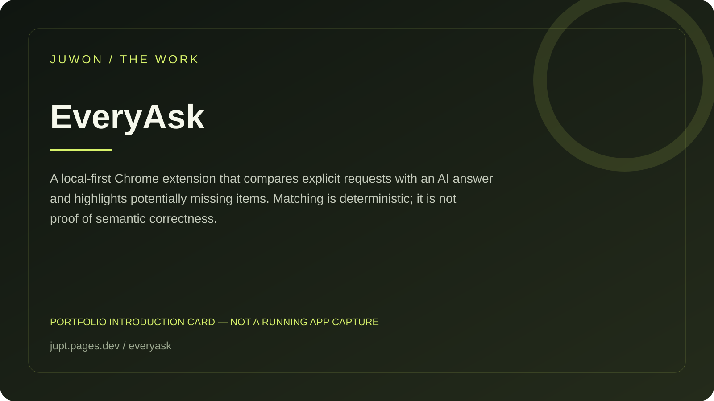

<!-- JUWON-PORTFOLIO-INTRO:START -->
# EveryAsk



*Portfolio introduction card, not a screenshot of a running application.*

*포트폴리오 소개 카드입니다. 실행 화면 캡처가 아닙니다.*

## English

A local-first Chrome extension that compares explicit requests with an AI answer and highlights potentially missing items. Matching is deterministic; it is not proof of semantic correctness.

[View JUWON's portfolio](https://jupt.pages.dev/) · [Browse the project collection](https://jupt.pages.dev/projects)

**Scope:** This README presents the repository's documented intent and recorded visual evidence. It does not certify that every feature is complete, deployed, or currently working. Follow the original setup, safety, and license documentation below.

## 한국어

요청과 AI 답변을 대조해 빠진 요구사항과 필요한 후속 질문을 보여주는 확장.

[JUWON 포트폴리오 보기](https://jupt.pages.dev/) · [전체 프로젝트 보기](https://jupt.pages.dev/projects)

**확인 범위:** 저장소의 문서상 목적과 기록된 화면 근거를 소개합니다. 모든 기능의 완성·배포·현재 정상 작동을 보증하지 않습니다. 설치법·안전 주의사항·라이선스는 아래 기존 문서를 확인하세요.
<!-- JUWON-PORTFOLIO-INTRO:END -->

---

## Original documentation / 기존 문서

# EveryAsk

## Did AI answer everything?

> You asked AI for 7 things. It answered 3. EveryAsk shows you the missing 4.

EveryAsk is a local-first Chrome extension that checks the *shape* of an AI answer against the request you actually wrote. It turns the vague feeling of “the AI forgot something” into a visible list of answered, partial, missing, and unclear asks — then creates a focused follow-up for only the incomplete items.

No account. No model. No cloud. No auto-send. 🔎

## Why this exists

AI chat is optimized to produce an answer, not to prove that it covered every part of a compound request. People lose time rereading long replies, comparing them with the original prompt, and writing “you forgot #4” follow-ups.

EveryAsk adds a small missing layer beside the chat:

```text
1. Write the README        ✓ ANSWERED
2. Add unit tests          ✓ ANSWERED
3. Publish a release       ! MISSING

Copy follow-up:
Please answer these incomplete items only:
1. Publish a release
```

## Quick start

```bash
npm ci
npm run build
```

1. Open `chrome://extensions`.
2. Turn on **Developer mode**.
3. Choose **Load unpacked** and select this project's `dist/` folder.
4. Open a ChatGPT or Claude conversation containing a numbered, bulleted, checkbox, or multi-question request.
5. Click the EveryAsk icon, choose the conversation source, and click **Check this answer**.
6. Review the evidence and copy a follow-up only if needed.

The repository also includes a deterministic fixture:

```bash
npm test
npm run smoke
```

## What it checks

EveryAsk extracts explicit request items, then compares their meaningful terms with the latest visible assistant response. It uses deterministic matching, sentence evidence, basic negation detection, and an uncertainty flag. It is deliberately conservative: low-confidence evidence becomes **unclear** instead of a confident green check.

Statuses:

- **Answered** — direct structural evidence found.
- **Partial** — some meaningful terms found, but coverage is incomplete.
- **Missing** — no supporting evidence found, or the answer explicitly says it was not done.
- **Unclear** — evidence is too weak or expressed with uncertainty.

This is coverage, not truth. EveryAsk cannot verify factual correctness, code quality, intent, or whether an answer truly solved the task.

## Privacy boundary

EveryAsk uses a user-invoked `activeTab` + `scripting` check. The popup injects a small collector only after you click the button, reads the latest recognized user and assistant blocks, and keeps the result in popup memory.

- No network calls.
- No cookies, history, clipboard reads, analytics, or persistent storage.
- No broad `host_permissions`.
- Clipboard write happens only when you click **Copy follow-up**.
- It never clicks Send or changes the AI conversation.

Chrome's `activeTab` permission is designed for temporary access after an explicit user gesture, and `scripting` can use that temporary access without broad host permissions. See the [Chrome permissions reference](https://developer.chrome.com/docs/extensions/reference/permissions-list) and [activeTab documentation](https://developer.chrome.com/docs/extensions/develop/concepts/activeTab).

## Supported pages and limits

The first adapter recognizes common ChatGPT message attributes and common Claude test IDs. AI sites can change their DOM; if EveryAsk cannot recognize both sides, it fails closed and explains that no conversation was found. The adapter interface is intentionally small so more providers can be added with fixtures rather than hidden scraping.

EveryAsk checks the latest recognized pair, not an entire conversation history. It also does not use an AI model to judge semantic equivalence. That keeps the first version free, inspectable, and predictable — while making false matches possible for paraphrased asks.

## Design promise

EveryAsk helps answer one narrow question:

> “Did this reply visibly address each part of my request?”

It does not pretend to answer these harder questions:

- “Is the response true?”
- “Is the code safe?”
- “Did the agent actually run the command?”

## Roadmap

- Provider adapter fixtures for Gemini, Grok, and local chat UIs.
- User-reviewed aliases for common terms and project vocabulary.
- Optional export of a review as a Markdown checklist, still local-only.
- Small, opt-in user study measuring whether follow-up turns decrease.

## Product hypothesis

First users are developers, students, researchers, and operators who routinely put 3+ deliverables into one AI request. The first ten users can be found through open-source AI tooling communities and browser-extension feedback channels without paid advertising.

Free distribution is the experiment. A future revenue hypothesis is a paid team policy/analytics layer only if users first prove that the local checker saves repeated review time; the core local checker should remain free and open.

## Contributing and security

Read [CONTRIBUTING.md](CONTRIBUTING.md) and [SECURITY.md](SECURITY.md). Every behavior change needs a focused test. Keep the permission boundary narrow.

## License

MIT © 2026 juwonllee2024-dotcom.
